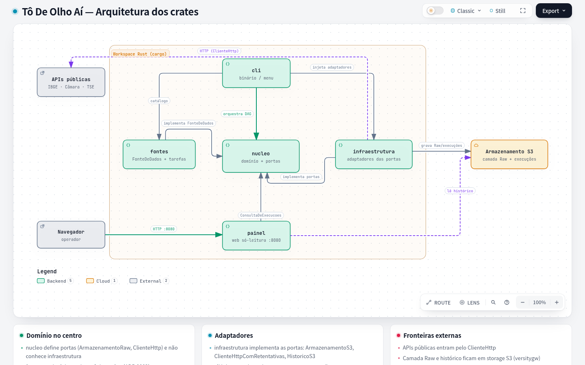
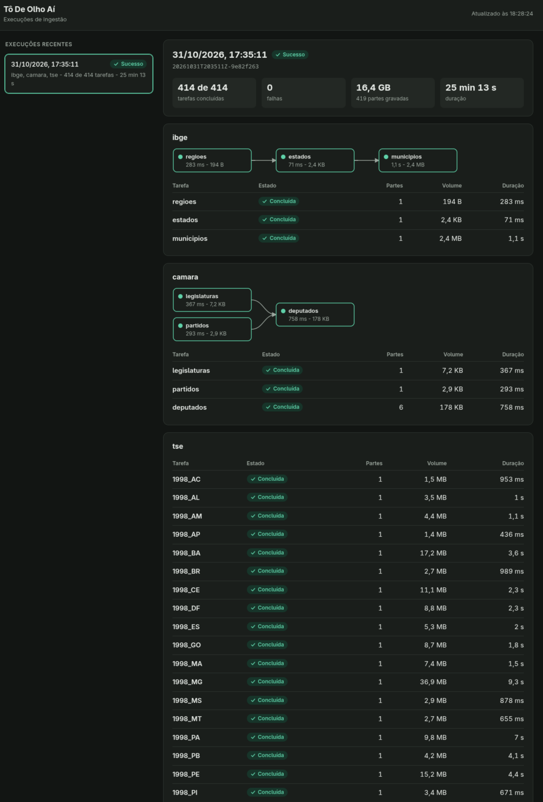
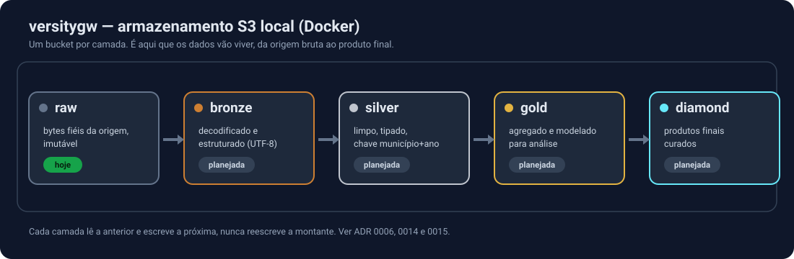

# Tô De Olho Aí

O **Tô De Olho Aí** ingere, transforma e apresenta dados públicos para que a população tenha uma fonte
para consultar quando estiver diante de assuntos da sociedade.

📖 **Documentação:** <https://rikemorais.github.io/todeolhoaibr/> (ADRs, fontes, diagramas e referência de API).

[](docs/diagramas/arquitetura-crates.html)

> Prévia da arquitetura. Abra o [diagrama de arquitetura](docs/diagramas/arquitetura-crates.html) ou o
> [fluxo da ingestão](docs/diagramas/fluxo-ingestao.html) no navegador para a versão **Live** — animada e
> interativa (o GitHub não executa o JavaScript do diagrama aqui dentro). Diagramas gerados com
> [Archify](https://github.com/tt-a1i/archify).

## Estado atual

| Etapa | Situação |
| --- | --- |
| Ingestão para a camada Raw | Disponível |
| Painel de acompanhamento das execuções | Disponível |
| Bronze | Disponível para as fontes do catálogo |
| Silver | Em implementação; consulte [cobertura e limitações](docs/refino/silver.md) |
| Apresentação | A definir |

### Fontes de dados

| Fonte | Recursos ingeridos | Documentação |
| --- | --- | --- |
| `ibge` | regiões, estados, municípios | [API de Localidades](https://servicodados.ibge.gov.br/api/docs/localidades) |
| `camara` | legislaturas, partidos, deputados em exercício | [Dados Abertos da Câmara](https://dadosabertos.camara.leg.br/swagger/api.html) |
| `camara-despesas` | despesas da CEAP, por ano desde 2008 (sob demanda) | [doc da fonte](docs/fontes/camara-despesas.md) · [CEAP](https://dadosabertos.camara.leg.br/howtouse/2023-12-26-dados-ceap.html) |
| `camara-votacoes` | proposições e votos nominais da Câmara, por ano (sob demanda) | [doc da fonte](docs/fontes/camara-votacoes.md) |
| `camara-tramitacoes` | histórico de tramitações das proposições da Câmara, por ano desde 2001 (sob demanda, volume alto) | [doc da fonte](docs/fontes/camara-tramitacoes.md) |
| `senado-votacoes` | matérias e votos nominais do Senado, por ano (sob demanda) | [doc da fonte](docs/fontes/senado-votacoes.md) |
| `senado-processos` | processos legislativos do Senado, por ano desde 1826 (sob demanda) | [doc das fontes do Senado](docs/fontes/senado-processos-e-parlamentares.md) |
| `senado-processos-detalhes` | detalhes e histórico dos processos do Senado, por ano (sob demanda, volume alto) | [doc das fontes do Senado](docs/fontes/senado-processos-e-parlamentares.md) |
| `senado-parlamentares` | senadores, partidos, UFs e mandatos por legislatura desde 1991 (sob demanda) | [doc das fontes do Senado](docs/fontes/senado-processos-e-parlamentares.md) |
| `tse` | votos por seção eleitoral, de 1998 a 2026 (16,4 GB) | [Portal de Dados Abertos do TSE](https://dadosabertos.tse.jus.br/) |

## Como rodar

Só é preciso ter o [Docker](https://docs.docker.com/get-docker/) com Compose. Nenhuma conta ou token é necessário.

```bash
git clone https://github.com/rikemorais/todeolhoaibr.git
cd todeolhoaibr

# Sobe armazenamento, painel e agendador do bronze. Na primeira vez, compila a imagem.
docker compose up -d --build

# Abre o menu para escolher o que ingerir
docker compose run --rm --build ingestao
```

O `agendador` faz uma primeira reconciliação ao iniciar e repete a cada hora. Se ainda não houver dados na Raw, não há o que refinar; depois da ingestão, o bronze será produzido na próxima passada. Para produzi-lo imediatamente, rode `docker compose run --rm refino refinar bronze --todas`. Veja [como processar e conferir o bronze](docs/refino/bronze.md#como-rodar).

Para gerar Silver manualmente, rode `docker compose run --rm refino refinar silver bcb` para séries BCB/SGS, `docker compose run --rm refino refinar silver ibge-ipca` para uma fonte IBGE, `docker compose run --rm refino refinar silver tse-candidaturas` para os consolidados nacionais de candidaturas por eleição, `docker compose run --rm refino refinar silver tse-bens` para os bens declarados pelos candidatos, `docker compose run --rm refino refinar silver senado-despesas` para as despesas anuais da CEAPS, `docker compose run --rm refino refinar silver senado-parlamentares` para parlamentares por legislatura, `docker compose run --rm refino refinar silver senado-votacoes` para as sessões e os votos individuais do Senado, `docker compose run --rm refino refinar silver senado-processos` para o catálogo anual de processos, `docker compose run --rm refino refinar silver senado-processos-detalhes` para detalhes e histórico dos processos do Senado, `docker compose run --rm refino refinar silver camara-despesas` para as despesas anuais da CEAP, `docker compose run --rm refino refinar silver camara-tramitacoes` para o histórico anual de tramitações da Câmara, `docker compose run --rm refino refinar silver camara-partidos` para o cadastro de partidos, `docker compose run --rm refino refinar silver camara-legislaturas` para os períodos da Câmara, `docker compose run --rm refino refinar silver camara-deputados` para a fotografia atual dos deputados em exercício, `docker compose run --rm refino refinar silver camara-votacoes` para os sete conjuntos anuais de proposições e votações, ou `docker compose run --rm refino refinar silver --todas` para todas as fontes atualmente suportadas. A reconciliação periódica Silver pode ser iniciada com `docker compose run --rm refino refinar silver --todas --intervalo 3600`. Veja o [contrato e a cobertura Silver](docs/refino/silver.md).

> **Use `--build` depois de mudar o código.** Na primeira vez, o Compose constrói a imagem sozinho (não há imagem local). Depois disso, `docker compose run`/`up` **reaproveitam a imagem já construída** e não enxergam mudanças no código — uma fonte recém-adicionada, por exemplo, não aparece no menu. O `--build` **força a reconstrução mesmo quando já existe imagem local**, então inclua-o após um `git pull` ou alteração no código (é rápido quando nada mudou, pelo cache de camadas).

**Atualizando uma instalação que só tinha Raw:** após `git pull`, rode `docker compose up -d --build`. Atualizar os arquivos da branch sozinho não executa o bronze: o Compose precisa criar o novo `agendador` com a imagem atualizada. O volume da Raw continua disponível; a primeira passada do agendador encontra os recursos já ingeridos e produz os Parquets ausentes no bucket `bronze`. Não é preciso ingerir a Raw outra vez. Para acompanhar, use `docker compose ps agendador` e `docker compose logs --tail=50 agendador`.

### Escolhendo o que ingerir

Nem todo computador tem espaço para tudo, então **você escolhe o que baixar e vê quanto falta baixar antes de começar**. A coluna “Falta baixar” considera o que já está íntegro na camada Raw: uma tarefa reaproveitada mostra 0 B. O rodapé soma as estimativas conhecidas. Um `+` indica que há tarefas sem estimativa e que o valor da linha é parcial. As fontes `sob demanda` aparecem como “a consultar” para evitar centenas de consultas à origem só para abrir o menu. Depois da escolha, a CLI estima apenas as tarefas selecionadas e mostra quanto falta baixar antes de pedir confirmação:

```text
Fontes disponíveis:

  Fonte                Falta baixar  Descrição
  1) ibge                    2,4 MB  IBGE - Regiões, Estados e Municípios do Brasil
  2) camara                196,3 KB  Câmara dos Deputados - legislaturas, partidos e deputados em exercício
  3) camara-despesas    a consultar  Câmara dos Deputados - despesas da CEAP, um arquivo por ano desde 2008
  4) camara-votacoes    a consultar  Câmara dos Deputados - proposições e votações nominais, um arquivo por ano desde 2001
  5) senado-votacoes    a consultar  Senado Federal - matérias e votações nominais, uma consulta por ano desde 1991
  6) tse                a consultar  TSE - Votos por seção eleitoral, de 1998 a 2026

Total conhecido: 2,6 MB
Total parcial: fontes a consultar: 4; tarefas sem estimativa: 0. + indica valor parcial.
```

Antes de executar, o projeto compara o espaço necessário com o espaço livre e pede confirmação. **Se não couber, a execução é recusada.**
No primeiro prompt, **Enter seleciona todas as fontes e tarefas sem perguntas adicionais**, inclusive as `sob demanda`; digite `q` para sair sem executar. Isso é diferente de `executar --todas`, que exclui as fontes `sob demanda`.
Uma combinação de filtros sem tarefas, mesmo quando cada valor existe isoladamente, produz um erro que mostra a combinação solicitada.

A ingestão é **idempotente**: antes de baixar, o projeto confere o que já existe na camada Raw e só (re)ingere o que está **ausente, desatualizado, menor ou incompleto**. O que continua igual é reaproveitado; as APIs paginadas usam requisição condicional (`If-None-Match`), e uma carga longa interrompida continua de onde parou. O painel indica, por tarefa, se foi reaproveitada ou reingerida e por quê (ver [ADR 0012](docs/adr/0012-pre-checagem-idempotente.md)).

No Mac e no Windows, o espaço livre mostrado é o do disco virtual do Docker, ajustável nas configurações do Docker Desktop.

Também é possível executar sem o menu:

```bash
# Uma UF de uma eleição
docker compose run --rm --build ingestao executar tse --filtro ano=2024 --filtro uf=AC

# Várias eleições e UFs
docker compose run --rm --build ingestao executar tse --filtro ano=2022,2024 --filtro uf=AC,SP

# Todas as fontes, exceto as muito grandes (o TSE só roda pelo nome)
docker compose run --rm --build ingestao executar --todas

# Sem a pergunta de confirmação, para automações. A verificação de espaço continua valendo.
docker compose run --rm --build -T ingestao executar ibge --sim

# Lista as fontes e mostra a ordem de execução de uma DAG, sem acessar a rede
# (com a imagem já construída; sem --build para não recompilar, que exigiria rede).
docker compose run --rm ingestao listar
docker compose run --rm ingestao plano camara
```

### Votos do TSE

Cada eleição tem um ZIP por UF, com um CSV em que cada linha traz UF, município, zona, seção, cargo, candidato e votos. Esse conjunto único permite consultar por seção, cidade e estado, mas
**essas consultas dependem da etapa de transformação, ainda a definir**. Por enquanto, os ZIPs ficam na camada Raw sem alteração, em `tse/votacao_secao/ano=AAAA/uf=UF/`.

- Os arquivos usam a codificação Latin-1 e `;` como separador.
- Descompactados, chegam a 8 vezes o tamanho do ZIP. O aviso de espaço cobre só os ZIPs.
- Para 1994 e 1996, o TSE não publica votos por seção.

### Configuração

O projeto funciona sem nenhuma configuração. Para mudar portas, credenciais locais ou outras opções, crie o seu `.env`:

```bash
cp .env.example .env
```

Todas as variáveis estão descritas em [`.env.example`](.env.example). O `.env` fica fora do Git. Se a compilação ficar
pesada na sua máquina, use `TODEOLHO_BUILD_JOBS=1`.

### Fontes com autenticação ou limite de taxa

As fontes atuais são anônimas. Para uma fonte que exija token, o código declara em `perfil_http()`
o nome da variável de ambiente, o cabeçalho, o prefixo e o host autorizado. A CLI lê o valor
da variável antes de executar a fonte e falha com o nome da variável se ela estiver ausente.
O token deve ser obtido no portal da respectiva fonte, conforme a documentação dessa fonte,
e passado ao container `ingestao` por variável de ambiente; nunca deve ser incluído no Git
ou em um comando que fique registrado no histórico do shell. O token é enviado apenas ao host
declarado e redirecionamentos automáticos são desativados para esse cliente. Respostas 401/403
marcam a tarefa como falha e indicam que é preciso conferir a credencial e as permissões.
O limite declarado também vale para novas tentativas e é compartilhado entre fontes que usam
o mesmo host. Detalhes da decisão: [ADR 0013](docs/adr/0013-autenticacao-e-limite-de-taxa-no-cliente-http.md).

Depois de obter o token, exporte a variável indicada pela documentação da fonte em seu ambiente
e passe apenas o nome dela ao Compose: `docker compose run --rm --build --env NOME_DA_VARIAVEL
ingestao executar NOME_DA_FONTE`. O Compose não repassa automaticamente variáveis novas do `.env`
ao serviço `ingestao`.

### Acompanhando as execuções

Abra **<http://localhost:8080>**. O painel mostra as 50 execuções mais recentes e, em cada uma, a DAG de cada fonte,
com o estado, o volume, a duração e o erro de cada tarefa. A página se atualiza sozinha e acompanha a execução em andamento.

O selo da camada identifica o estágio da execução: **Raw** aparece em cinza, **Bronze** em marrom médio; os selos de **Silver**, **Gold** e **Diamond** já têm, respectivamente, azul, amarelo sol e roxo definidos para quando essas camadas forem implementadas.



| Situação | Significado |
| --- | --- |
| Em andamento | A ingestão está rodando |
| Sucesso | Todas as tarefas foram concluídas |
| Com falhas | A execução terminou, mas alguma tarefa falhou. As tarefas que dependem dela ficam como "Ignorada" |
| Interrompida | O processo parou sem concluir e está há mais de 5 minutos sem dar sinal |

O painel é somente leitura e fica acessível apenas a partir da própria máquina. Ele não tem autenticação, então não o
exponha na internet.

### Acessando os dados

O armazenamento é o **[versitygw](https://github.com/versity/versitygw)**, um gateway S3 que roda localmente no Docker ([ADR 0005](docs/adr/0005-armazenamento-s3-com-versitygw.md)). É nele que os dados vivem, hoje nos buckets `raw` e `bronze` e, no futuro, nas camadas `silver`, `gold` e `diamond` (ver [Camadas de dados](#camadas-de-dados)).

A forma mais simples de ver os arquivos é o **navegador de arquivos do versitygw**, em **<http://localhost:7071>**. Entre com a chave de acesso e a chave secreta
do `.env` (`TODEOLHO_S3_CHAVE_DE_ACESSO` e `TODEOLHO_S3_CHAVE_SECRETA`) e abra o bucket `raw` em **Explorer**. Use `localhost`: o
endereço `127.0.0.1` não funciona nessa tela.

**Cuidado:** essa interface permite enviar e apagar arquivos, e a camada Raw não deve ser alterada à mão.

A porta 7070 é a API S3, não um site. Abrir esse endereço no navegador resulta em `AccessDenied`, e isso é o esperado.

Os dados ficam em um volume Docker e são arquivos comuns:

```bash
# Lista os arquivos ingeridos
docker compose exec armazenamento find /dados/raw -type f

# Copia a camada Raw para a pasta ./raw-local
docker compose cp armazenamento:/dados/raw ./raw-local
```

Também é possível usar um cliente S3 em `http://localhost:7070`. A região e as credenciais são as de
`TODEOLHO_S3_REGIAO`, `TODEOLHO_S3_CHAVE_DE_ACESSO` e `TODEOLHO_S3_CHAVE_SECRETA`, descritas em
[`.env.example`](.env.example).

### Consultando o bronze com DuckDB

As tabelas em Parquet do `bronze` são consultadas com SQL pelo **[DuckDB](https://duckdb.org/)** — uma "Athena local" que lê o Parquet **no lugar**, sem mover os dados ([ADR 0018](docs/adr/0018-motor-de-consulta-duckdb.md)). O serviço `consulta` sobe somente-leitura e já cria uma view por tabela (`bronze_<fonte>_<recurso>`, ex.: `bronze_camara_despesas`), com `ano`, `data_ingestao` e `execucao` vindos do caminho.

```bash
# Console SQL web (editor + lista de tabelas), self-hosted, em http://localhost:4213
docker compose up -d --build consulta

# SQL no terminal (offline), com as views já carregadas
docker compose run --rm --build consulta sql
```

```sql
-- Exemplos (no console web ou no CLI)
SELECT ano, count(*) FROM bronze_camara_despesas GROUP BY ano ORDER BY ano;
SELECT * FROM bronze_camara_despesas LIMIT 10;

-- Também dá para ler direto do versitygw, sem a view:
SELECT count(*) FROM read_parquet('s3://bronze/camara/despesas/ano=2024/**/*.parquet');
```

> O **console web** (`localhost:4213`) é nosso, self-hosted: não depende de serviço externo e as queries rodam 100% locais. A DuckDB Local UI oficial (`docker compose run --rm --service-ports consulta ui`) existe, mas depende da nuvem MotherDuck e costuma falhar na inicialização ([issue #167](https://github.com/rikemorais/todeolhoaibr/issues/167)); prefira o console web ou o `consulta sql`.

### Encerrando

```bash
# Para os serviços e mantém os dados
docker compose down

# Para os serviços e APAGA todos os dados ingeridos e o histórico de execuções
docker compose down -v
```

## Arquitetura

```text
 APIs públicas                    todeolho (CLI)                   Camada Raw
+-------------+    HTTP    +--------------------------+    S3    +-------------+
| IBGE        | ---------> | Fonte -> DAG -> Executor | -------> | versitygw   |
| Câmara      |            +--------------------------+          | (volume)    |
+-------------+                 | histórico                      +-------------+
                                 v
                         +---------------+    S3    +-------------+    HTTP
                         | bucket        | <------- | Painel      | -------> Navegador
                         | execucoes     |          +-------------+
                         +---------------+
```

Cada API é uma fonte, e cada fonte gera uma DAG cujas tarefas gravam as respostas sem alteração:

```text
raw/<fonte>/<recurso>/data_ingestao=AAAA-MM-DD/execucao=<id>/parte-00001.json
raw/<fonte>/<recurso>/data_ingestao=AAAA-MM-DD/execucao=<id>/_manifesto.json
```

O manifesto é gravado por último, então um prefixo sem ele é de uma ingestão incompleta.

### Camadas de dados

Os dados ficam no versitygw organizados em **medalhão**: cada camada é um bucket, e cada estágio lê a anterior e escreve a próxima, sem nunca reescrever a montante ([ADR 0014](docs/adr/0014-raw-opaca-e-refino-em-estagio-separado.md) e [ADR 0015](docs/adr/0015-arquitetura-de-dados-em-medalhao.md)). Raw e Bronze atendem o catálogo de ingestão/refino; Silver já materializa séries BCB/SGS, agregados IBGE e parlamentares do Senado com contratos iniciais, enquanto as demais fontes seguem em implementação.



- **`raw`** — bytes fiéis da origem, imutável (existe hoje).
- **`bronze`** — decodificado e estruturado (descompactado, UTF-8), 1:1 com a origem (existe hoje; consultável com DuckDB, ver [Consultando o bronze com DuckDB](#consultando-o-bronze-com-duckdb)).
- **`silver`** — contratos tipados e conformados por tabela; as séries BCB e os agregados IBGE são as primeiras fontes materializadas. As demais fontes ainda estão em implementação.
- **`gold`** — agregado e modelado para análise e consumo (os cruzamentos).
- **`diamond`** — produtos finais curados (índices, datasets de correlação, *features*).

```text
crates/
  nucleo/          Contratos, DAG (Dagron), executor e contrato da camada Raw
  fontes/          As APIs públicas e o catálogo
  refino/          Decodifica a Raw para o medalhão (bronze em Parquet)
  infraestrutura/  Implementações de S3 e HTTP
  painel/          Painel web das execuções
  cli/             Comandos e composição da aplicação
docker/            Imagem da ingestão/refino e o serviço de consulta (DuckDB)
docs/adr/          Decisões de arquitetura
```

As intenções e os motivos de cada decisão estão nos [ADRs](docs/adr/README.md).

## Como adicionar uma fonte de dados

O projeto usa o padrão Factory Method ([ADR 0004](docs/adr/0004-factory-method-para-fontes.md)). Nada além da
nova fonte precisa mudar.

**1.** Crie `crates/fontes/src/fontes/minha_fonte.rs`, declarando as tarefas e suas dependências:

```rust
use todeolho_nucleo::{FonteDeDados, TarefaPlanejada};

use crate::ingestao_http::TarefaDeIngestaoHttp;

const NOME: &str = "minha_fonte";
const BASE: &str = "https://api.exemplo.gov.br/v1";

pub struct MinhaFonte;

impl FonteDeDados for MinhaFonte {
    fn nome(&self) -> &str {
        NOME
    }

    fn descricao(&self) -> &str {
        "Descrição curta da fonte"
    }

    fn criar_tarefas(&self) -> Vec<TarefaPlanejada> {
        let tarefa = |recurso: &str| {
            TarefaDeIngestaoHttp::sem_paginacao(NOME, recurso, format!("{BASE}/{recurso}"))
        };

        vec![
            TarefaPlanejada::nova(tarefa("orgaos")),
            TarefaPlanejada::nova(tarefa("despesas")).depois_de(["orgaos"]),
        ]
    }
}
```

**2.** Declare o módulo em `crates/fontes/src/fontes/mod.rs` e registre a fonte em `crates/fontes/src/lib.rs`:

```rust
pub fn catalogo() -> Vec<Box<dyn FonteDeDados>> {
    vec![
        Box::new(FonteIbge),
        Box::new(FonteCamara),
        Box::new(FonteTse),
        Box::new(MinhaFonte),
    ]
}
```

Para que o menu mostre o tamanho e permita filtrar:

- **Tamanho:** use `.com_tamanho_tipico(bytes)` em APIs. Em arquivos, `TarefaDeArquivo` consulta o tamanho na origem.
- **Filtros:** use `.com_etiquetas([("ano", "2024"), ("uf", "AC")])` em cada tarefa. Filtros e menu são gerados a partir das etiquetas.
- **Fontes muito grandes:** implemente `sob_demanda` retornando `true`, para ficarem fora de `--todas`.

Se a API paginar de outra forma, implemente `EstrategiaDePaginacao` e use `TarefaDeIngestaoHttp::paginada`. Para arquivos grandes, use `TarefaDeArquivo`, que não os carrega na memória. Se a origem
for diferente, implemente `Tarefa` diretamente.

## Desenvolvimento

Para trabalhar no código, instale o [Rust](https://rustup.rs/). Os testes não precisam de Docker nem de rede externa; os testes HTTP e S3 usam servidores locais em loopback:

```bash
cargo test --workspace
cargo llvm-cov --workspace --fail-under-lines 77.9
cargo clippy --workspace --all-targets
cargo fmt --all
```

Para medir cobertura localmente, instale as ferramentas uma vez e rode o mesmo
comando usado pelo CI:

```bash
rustup component add llvm-tools-preview
cargo install cargo-llvm-cov --version 0.9.1 --locked
cargo llvm-cov --workspace --locked --fail-under-lines 77.9
```

O resumo por arquivo é exibido no terminal. O limite inicial é 77,9% de linhas,
medido em 2 de novembro de 2026; aumente-o quando a cobertura crescer.

Os testes de integração do adaptador S3 (`armazenamento_s3`) são marcados com `#[ignore]` — o `cargo test` padrão os reporta como *ignored*, não como aprovados. Para rodá-los contra o versitygw local, suba-o e passe o endpoint:

```bash
docker compose up -d armazenamento
TODEOLHO_TESTE_S3_ENDPOINT=http://localhost:7070 \
  cargo test -p todeolho-infraestrutura armazenamento_s3 -- --ignored
```

Se você customizou `TODEOLHO_S3_PORTA`, use essa porta no endpoint. As credenciais e a região caem para as variáveis `TODEOLHO_S3_*` do seu ambiente quando as `TODEOLHO_TESTE_S3_*` não estão definidas.

Depois de alterar o código, reconstrua a imagem e reinicie o painel com `docker compose up -d --build`.

O projeto usa [Conventional Commits](https://www.conventionalcommits.org/pt-br/v1.0.0/) e [Versionamento Semântico](https://semver.org/lang/pt-BR/). As regras estão no
[ADR 0011](docs/adr/0011-versionamento-e-commits.md), e as mudanças de cada versão, no [`CHANGELOG.md`](CHANGELOG.md).

## Licença

Licenciado sob qualquer uma das opções abaixo, à sua escolha:

- Licença MIT ([`LICENSE-MIT`](LICENSE-MIT) ou <https://opensource.org/licenses/MIT>)
- Licença Apache, Versão 2.0 ([`LICENSE-APACHE`](LICENSE-APACHE) ou <https://www.apache.org/licenses/LICENSE-2.0>)

Salvo declaração explícita em contrário, qualquer contribuição enviada para
inclusão neste projeto, conforme definido na Apache-2.0, será licenciada sob
esses dois termos, sem cláusulas adicionais.
