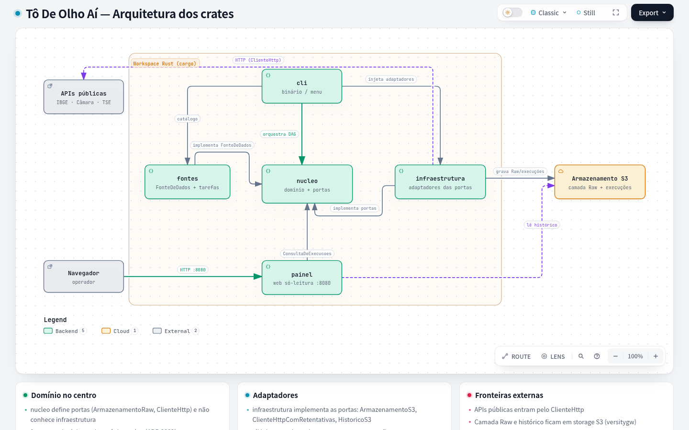
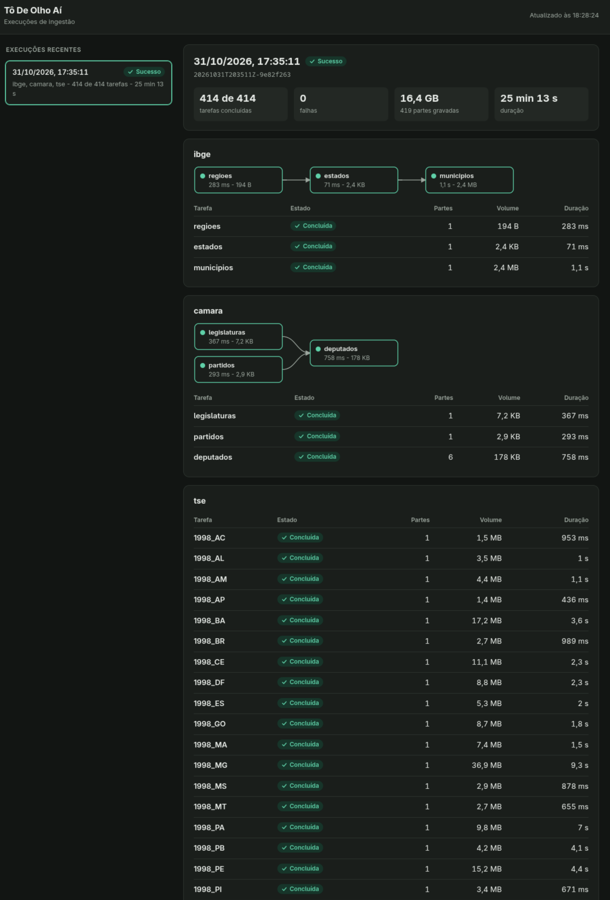
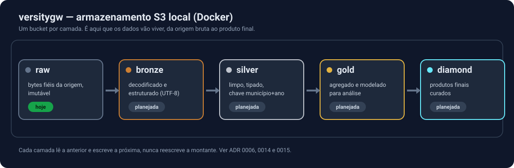

# Tô De Olho Aí

O **Tô De Olho Aí** ingere, transforma e apresenta dados públicos para que a população tenha uma fonte
para consultar quando estiver diante de assuntos da sociedade.

[](docs/diagramas/arquitetura-crates.html)

> Prévia da arquitetura. Abra o [diagrama de arquitetura](docs/diagramas/arquitetura-crates.html) ou o
> [fluxo da ingestão](docs/diagramas/fluxo-ingestao.html) no navegador para a versão **Live** — animada e
> interativa (o GitHub não executa o JavaScript do diagrama aqui dentro). Diagramas gerados com
> [Archify](https://github.com/tt-a1i/archify).

## Estado atual

| Etapa | Situação |
| --- | --- |
| Ingestão para a camada Raw | Disponível |
| Painel de acompanhamento das execuções | Disponível |
| Transformação | A definir |
| Apresentação | A definir |

### Fontes de dados

| Fonte | Recursos ingeridos | Documentação |
| --- | --- | --- |
| `ibge` | regiões, estados, municípios | [API de Localidades](https://servicodados.ibge.gov.br/api/docs/localidades) |
| `camara` | legislaturas, partidos, deputados em exercício | [Dados Abertos da Câmara](https://dadosabertos.camara.leg.br/swagger/api.html) |
| `camara-despesas` | despesas da CEAP, por ano desde 2008 (sob demanda) | [doc da fonte](docs/fontes/camara-despesas.md) · [CEAP](https://dadosabertos.camara.leg.br/howtouse/2023-12-26-dados-ceap.html) |
| `tse` | votos por seção eleitoral, de 1998 a 2026 (16,4 GB) | [Portal de Dados Abertos do TSE](https://dadosabertos.tse.jus.br/) |

## Como rodar

Só é preciso ter o [Docker](https://docs.docker.com/get-docker/) com Compose. Nenhuma conta ou token é necessário.

```bash
git clone https://github.com/rikemorais/todeolhoaibr.git
cd todeolhoaibr

# Sobe o armazenamento e o painel. Na primeira vez, compila a imagem e leva alguns minutos.
docker compose up -d --build

# Abre o menu para escolher o que ingerir
docker compose run --rm --build ingestao
```

> **Use `--build` depois de mudar o código.** Na primeira vez, o Compose constrói a imagem sozinho (não há imagem local). Depois disso, `docker compose run`/`up` **reaproveitam a imagem já construída** e não enxergam mudanças no código — uma fonte recém-adicionada, por exemplo, não aparece no menu. O `--build` **força a reconstrução mesmo quando já existe imagem local**, então inclua-o após um `git pull` ou alteração no código (é rápido quando nada mudou, pelo cache de camadas).

### Escolhendo o que ingerir

Nem todo computador tem espaço para tudo, então **você escolhe o que baixar e vê o tamanho antes de começar**. O menu mostra o tamanho de cada fonte e, quando
ela permite, de cada ano e UF:

```text
Fontes disponíveis:

  1) ibge        2,4 MB  IBGE - Regiões, Estados e Municípios do Brasil
  2) camara    196,3 KB  Câmara dos Deputados - legislaturas, partidos e deputados em exercício
  3) tse        16,4 GB  TSE - Votos por seção eleitoral, de 1998 a 2026
```

Antes de executar, o projeto compara o espaço necessário com o espaço livre e pede confirmação. **Se não couber, a execução é recusada.**

A ingestão é **idempotente**: antes de baixar, o projeto confere o que já existe na camada Raw e só (re)ingere o que está **ausente, desatualizado, menor ou incompleto**. O que continua igual é reaproveitado; as APIs paginadas usam requisição condicional (`If-None-Match`), e uma carga longa interrompida continua de onde parou. O painel indica, por tarefa, se foi reaproveitada ou reingerida e por quê (ver [ADR 0012](docs/adr/0012-pre-checagem-idempotente.md)).

No Mac e no Windows, o espaço livre mostrado é o do disco virtual do Docker, ajustável nas configurações do Docker Desktop.

Também é possível executar sem o menu:

```bash
# Uma UF de uma eleição
docker compose run --rm --build ingestao executar tse --filtro ano=2024 --filtro uf=AC

# Várias eleições e UFs
docker compose run --rm --build ingestao executar tse --filtro ano=2022,2024 --filtro uf=AC,SP

# Todas as fontes, exceto as muito grandes (o TSE só roda pelo nome)
docker compose run --rm --build ingestao executar --todas

# Sem a pergunta de confirmação, para automações. A verificação de espaço continua valendo.
docker compose run --rm --build -T ingestao executar ibge --sim

# Lista as fontes e mostra a ordem de execução de uma DAG, sem acessar a rede
# (com a imagem já construída; sem --build para não recompilar, que exigiria rede).
docker compose run --rm ingestao listar
docker compose run --rm ingestao plano camara
```

### Votos do TSE

Cada eleição tem um ZIP por UF, com um CSV em que cada linha traz UF, município, zona, seção, cargo, candidato e votos. Esse conjunto único permite consultar por seção, cidade e estado, mas
**essas consultas dependem da etapa de transformação, ainda a definir**. Por enquanto, os ZIPs ficam na camada Raw sem alteração, em `tse/votacao_secao/ano=AAAA/uf=UF/`.

- Os arquivos usam a codificação Latin-1 e `;` como separador.
- Descompactados, chegam a 8 vezes o tamanho do ZIP. O aviso de espaço cobre só os ZIPs.
- Para 1994 e 1996, o TSE não publica votos por seção.

### Configuração

O projeto funciona sem nenhuma configuração. Para mudar portas, credenciais locais ou outras opções, crie o seu `.env`:

```bash
cp .env.example .env
```

Todas as variáveis estão descritas em [`.env.example`](.env.example). O `.env` fica fora do Git. Se a compilação ficar
pesada na sua máquina, use `TODEOLHO_BUILD_JOBS=1`.

### Acompanhando as execuções

Abra **<http://localhost:8080>**. O painel mostra as 50 execuções mais recentes e, em cada uma, a DAG de cada fonte,
com o estado, o volume, a duração e o erro de cada tarefa. A página se atualiza sozinha e acompanha a execução em andamento.



| Situação | Significado |
| --- | --- |
| Em andamento | A ingestão está rodando |
| Sucesso | Todas as tarefas foram concluídas |
| Com falhas | A execução terminou, mas alguma tarefa falhou. As tarefas que dependem dela ficam como "Ignorada" |
| Interrompida | O processo parou sem concluir e está há mais de 5 minutos sem dar sinal |

O painel é somente leitura e fica acessível apenas a partir da própria máquina. Ele não tem autenticação, então não o
exponha na internet.

### Acessando os dados

O armazenamento é o **[versitygw](https://github.com/versity/versitygw)**, um gateway S3 que roda localmente no Docker ([ADR 0005](docs/adr/0005-armazenamento-s3-com-versitygw.md)). É nele que os dados vivem, hoje no bucket `raw` e, no futuro, nas camadas `bronze`, `silver`, `gold` e `diamond` (ver [Camadas de dados](#camadas-de-dados)).

A forma mais simples de ver os arquivos é o **navegador de arquivos do versitygw**, em **<http://localhost:7071>**. Entre com a chave de acesso e a chave secreta
do `.env` (`TODEOLHO_S3_CHAVE_DE_ACESSO` e `TODEOLHO_S3_CHAVE_SECRETA`) e abra o bucket `raw` em **Explorer**. Use `localhost`: o
endereço `127.0.0.1` não funciona nessa tela.

**Cuidado:** essa interface permite enviar e apagar arquivos, e a camada Raw não deve ser alterada à mão.

A porta 7070 é a API S3, não um site. Abrir esse endereço no navegador resulta em `AccessDenied`, e isso é o esperado.

Os dados ficam em um volume Docker e são arquivos comuns:

```bash
# Lista os arquivos ingeridos
docker compose exec armazenamento find /dados/raw -type f

# Copia a camada Raw para a pasta ./raw-local
docker compose cp armazenamento:/dados/raw ./raw-local
```

Também é possível usar um cliente S3 em `http://localhost:7070`. A região e as credenciais são as de
`TODEOLHO_S3_REGIAO`, `TODEOLHO_S3_CHAVE_DE_ACESSO` e `TODEOLHO_S3_CHAVE_SECRETA`, descritas em
[`.env.example`](.env.example).

### Encerrando

```bash
# Para os serviços e mantém os dados
docker compose down

# Para os serviços e APAGA todos os dados ingeridos e o histórico de execuções
docker compose down -v
```

## Arquitetura

```text
 APIs públicas                    todeolho (CLI)                   Camada Raw
+-------------+    HTTP    +--------------------------+    S3    +-------------+
| IBGE        | ---------> | Fonte -> DAG -> Executor | -------> | versitygw   |
| Câmara      |            +--------------------------+          | (volume)    |
+-------------+                 | histórico                      +-------------+
                                 v
                         +---------------+    S3    +-------------+    HTTP
                         | bucket        | <------- | Painel      | -------> Navegador
                         | execucoes     |          +-------------+
                         +---------------+
```

Cada API é uma fonte, e cada fonte gera uma DAG cujas tarefas gravam as respostas sem alteração:

```text
raw/<fonte>/<recurso>/data_ingestao=AAAA-MM-DD/execucao=<id>/parte-00001.json
raw/<fonte>/<recurso>/data_ingestao=AAAA-MM-DD/execucao=<id>/_manifesto.json
```

O manifesto é gravado por último, então um prefixo sem ele é de uma ingestão incompleta.

### Camadas de dados

Os dados ficam no versitygw organizados em **medalhão**: cada camada é um bucket, e cada estágio lê a anterior e escreve a próxima, sem nunca reescrever a montante. Hoje só existe o `raw`; as demais são o destino do refino, a jusante da ingestão ([ADR 0014](docs/adr/0014-raw-opaca-e-refino-em-estagio-separado.md) e [ADR 0015](docs/adr/0015-arquitetura-de-dados-em-medalhao.md)).



- **`raw`** — bytes fiéis da origem, imutável (existe hoje).
- **`bronze`** — decodificado e estruturado (descompactado, UTF-8), 1:1 com a origem.
- **`silver`** — limpo, tipado e conformado, com a chave canônica `município + ano`.
- **`gold`** — agregado e modelado para análise e consumo (os cruzamentos).
- **`diamond`** — produtos finais curados (índices, datasets de correlação, *features*).

```text
crates/
  nucleo/          Contratos, DAG (Dagron), executor e contrato da camada Raw
  fontes/          As APIs públicas e o catálogo
  infraestrutura/  Implementações de S3 e HTTP
  painel/          Painel web das execuções
  cli/             Comandos e composição da aplicação
docker/            Imagem da ingestão
docs/adr/          Decisões de arquitetura
```

As intenções e os motivos de cada decisão estão nos [ADRs](docs/adr/README.md).

## Como adicionar uma fonte de dados

O projeto usa o padrão Factory Method ([ADR 0004](docs/adr/0004-factory-method-para-fontes.md)). Nada além da
nova fonte precisa mudar.

**1.** Crie `crates/fontes/src/fontes/minha_fonte.rs`, declarando as tarefas e suas dependências:

```rust
use todeolho_nucleo::{FonteDeDados, TarefaPlanejada};

use crate::ingestao_http::TarefaDeIngestaoHttp;

const NOME: &str = "minha_fonte";
const BASE: &str = "https://api.exemplo.gov.br/v1";

pub struct MinhaFonte;

impl FonteDeDados for MinhaFonte {
    fn nome(&self) -> &str {
        NOME
    }

    fn descricao(&self) -> &str {
        "Descrição curta da fonte"
    }

    fn criar_tarefas(&self) -> Vec<TarefaPlanejada> {
        let tarefa = |recurso: &str| {
            TarefaDeIngestaoHttp::sem_paginacao(NOME, recurso, format!("{BASE}/{recurso}"))
        };

        vec![
            TarefaPlanejada::nova(tarefa("orgaos")),
            TarefaPlanejada::nova(tarefa("despesas")).depois_de(["orgaos"]),
        ]
    }
}
```

**2.** Declare o módulo em `crates/fontes/src/fontes/mod.rs` e registre a fonte em `crates/fontes/src/lib.rs`:

```rust
pub fn catalogo() -> Vec<Box<dyn FonteDeDados>> {
    vec![
        Box::new(FonteIbge),
        Box::new(FonteCamara),
        Box::new(FonteTse),
        Box::new(MinhaFonte),
    ]
}
```

Para que o menu mostre o tamanho e permita filtrar:

- **Tamanho:** use `.com_tamanho_tipico(bytes)` em APIs. Em arquivos, `TarefaDeArquivo` consulta o tamanho na origem.
- **Filtros:** use `.com_etiquetas([("ano", "2024"), ("uf", "AC")])` em cada tarefa. Filtros e menu são gerados a partir das etiquetas.
- **Fontes muito grandes:** implemente `sob_demanda` retornando `true`, para ficarem fora de `--todas`.

Se a API paginar de outra forma, implemente `EstrategiaDePaginacao` e use `TarefaDeIngestaoHttp::paginada`. Para arquivos grandes, use `TarefaDeArquivo`, que não os carrega na memória. Se a origem
for diferente, implemente `Tarefa` diretamente.

## Desenvolvimento

Para trabalhar no código, instale o [Rust](https://rustup.rs/). Os testes não precisam de Docker nem de rede:

```bash
cargo test --workspace
cargo clippy --workspace --all-targets
cargo fmt --all
```

Os testes de integração do adaptador S3 (`armazenamento_s3`) são marcados com `#[ignore]` — o `cargo test` padrão os reporta como *ignored*, não como aprovados. Para rodá-los contra o versitygw local, suba-o e passe o endpoint:

```bash
docker compose up -d armazenamento
TODEOLHO_TESTE_S3_ENDPOINT=http://localhost:7070 \
  cargo test -p todeolho-infraestrutura armazenamento_s3 -- --ignored
```

Se você customizou `TODEOLHO_S3_PORTA`, use essa porta no endpoint. As credenciais e a região caem para as variáveis `TODEOLHO_S3_*` do seu ambiente quando as `TODEOLHO_TESTE_S3_*` não estão definidas.

Depois de alterar o código, reconstrua a imagem e reinicie o painel com `docker compose up -d --build`.

O projeto usa [Conventional Commits](https://www.conventionalcommits.org/pt-br/v1.0.0/) e [Versionamento Semântico](https://semver.org/lang/pt-BR/). As regras estão no
[ADR 0011](docs/adr/0011-versionamento-e-commits.md), e as mudanças de cada versão, no [`CHANGELOG.md`](CHANGELOG.md).

## Licença

Licenciado sob qualquer uma das opções abaixo, à sua escolha:

- Licença MIT ([`LICENSE-MIT`](LICENSE-MIT) ou <https://opensource.org/licenses/MIT>)
- Licença Apache, Versão 2.0 ([`LICENSE-APACHE`](LICENSE-APACHE) ou <https://www.apache.org/licenses/LICENSE-2.0>)

Salvo declaração explícita em contrário, qualquer contribuição enviada para
inclusão neste projeto, conforme definido na Apache-2.0, será licenciada sob
esses dois termos, sem cláusulas adicionais.
